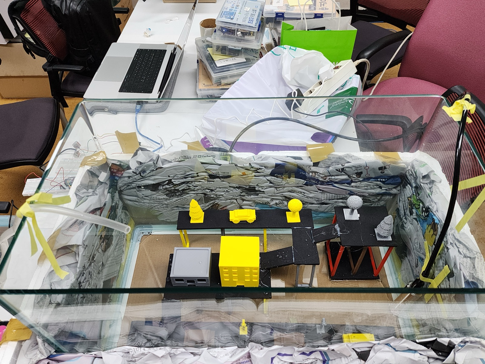
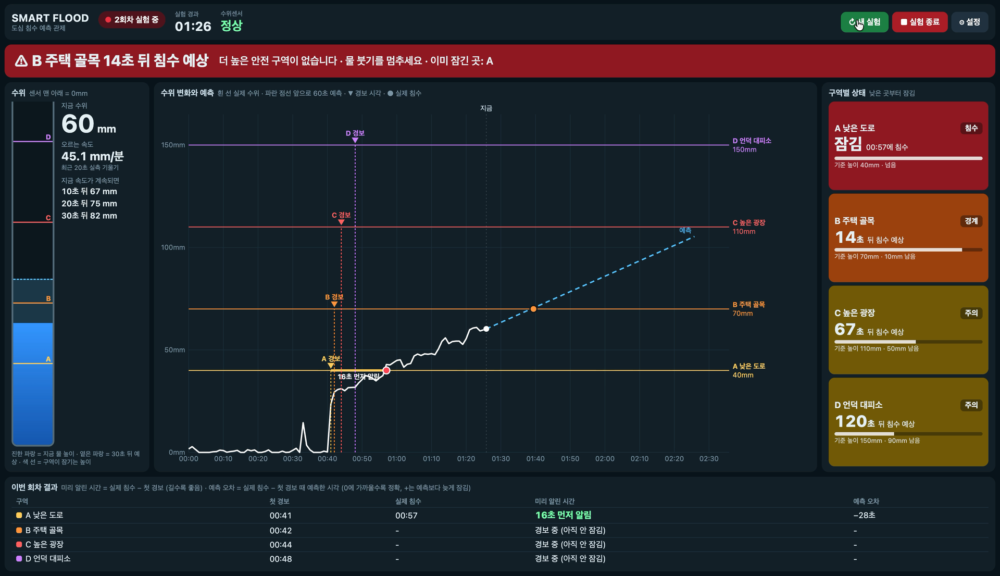
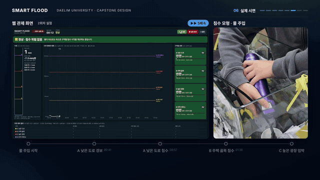

# SMART FLOOD

도시 침수 조기 경보 모형을 만드는 학교 R&D 프로젝트다

작은 도시 모형에 펌프로 비를 내리고 구역마다 차오르는 물을 잰다

지금 수위와 상승 속도로 구역마다 잠기기까지 남은 시간을 미리 계산한다

결과는 보드 화면과 관제 웹에 띄우고 문자로도 알린다

> **시험용이다**
>
> 모형 실험과 시연에만 쓰고 실제 재난 판단과 재난 문자에는 쓰지 않는다
>
> 시뮬레이션 결과와 한 회차의 화면 값은 예측 성능의 근거로 쓰지 않는다
>
> `backend/config.yaml` 에서 `ASSUMED` 가 붙은 계수는 실측 전 가정값이다

## 1. 문제 정의

도시 침수는 낮은 곳부터 차례로 번진다

- 큰비가 오면 빗물받이가 막히거나 넘쳐 낮은 도로와 골목에 물이 먼저 고인다
- 물이 차오르는 속도는 구역의 높이와 배수 상태에 따라 다르다
- 지금 수위만 알리는 경보는 물이 기준을 넘은 뒤에야 울린다
- 그때는 길이 이미 잠겨 대피할 시간도 경로도 남지 않는다

대피하려면 수위 숫자보다 아래 세 가지 답이 필요하다

| 물음 | 필요한 답 |
|---|---|
| 언제 | 내가 있는 구역이 잠기기까지 남은 시간 |
| 어디 | 먼저 잠기는 구역과 아직 안전한 구역 |
| 어떻게 | 지금 피해야 할 길과 가야 할 대피 장소 |

실제 도시에서는 이 답을 실험으로 확인하기 어렵다

그래서 작은 도시 모형에서 침수를 여러 번 일으키고 경보가 실제 침수보다 얼마나 먼저 나오는지 회차마다 잰다

## 2. 솔루션 개요

수위센서 하나와 ESP32 보드 한 대에 서버와 관제 웹을 이은 침수 조기 경보 모형이다

- 보드는 수위를 재고 최근 기울기로 구역마다 침수까지 남은 초를 계산한다
- 서버는 같은 수위를 받아 물수지 모델을 보정하고 위험 단계를 판정해 기록한다
- 관제 웹은 서버의 판정을 1초마다 읽어 배너·게이지·차트·평면도로 보여 준다
- 위험 단계가 바뀌면 알림을 보낸다

### 모형 도시

모형 도시는 높이가 다른 세 구역으로 나뉜다

| 구역 | 이름 | 위치 | 침수 기준 높이 |
|---|---|---|---|
| A | 낮은 상가 도로 | 가장 낮은 곳 | 40 mm |
| B | 주택 골목 | 가운데 | 70 mm |
| C | 높은 광장 | 가장 높은 곳이자 대피 장소 | 110 mm |

- 기준 높이는 수조 바닥을 0 으로 잰 값이고 보드 화면에서 고칠 수 있다
- 펌프가 급수통의 물을 끌어 올려 도시 위에 비를 뿌린다
- 빗물받이 ①·② 는 A 에 있고 ③ 은 B 에 있다
- 빗물받이를 부분 막힘이나 완전 막힘으로 바꿔 배수가 막힌 상황을 만든다
- 구역 사이에서는 수면이 높은 쪽에서 낮은 쪽으로 물이 넘친다

### 시스템 구성

```text
수위센서 + 플로트 --> ESP32 보드 --> 릴레이 --> 펌프 (비)
                         |
                         |  POST /api/ingest  1초마다
                         v
                FastAPI 서버  1초마다 계산
                모델 > 보정 > 위험 단계와 예측 > 기록
                   |                          |
                   |  GET /api/state          |  알림 포트
                   v                          v
           관제 웹  1초마다 읽음        기록만 (stub) 또는 시험 문자
```

| 부분 | 맡는 일 | 폴더 |
|---|---|---|
| 보드 | 측정 · 펌프 제어 · 현장 경보 · 휴대폰용 화면 | `firmware/` |
| 서버 | 모델 · 예측 · 위험 단계 · 기록 · 알림 | `backend/` |
| 관제 웹 | 표시 · 가상 실험 · 기록 재생 | `frontend/` |

- 보드는 서버 없이도 돌아서 서버가 꺼져도 측정·펌프 제어·경보가 이어진다
- 펌프는 보드만 켜고 끌 수 있고 서버의 출력 잠금(`outputsLocked`)은 늘 `true` 다
- 보드 화면은 보드가 연 `SMART_FLOOD` 와이파이에 붙은 기기에서만 열린다

## 3. 주요 기능 정의

| 기능 | 하는 일 | 맡는 곳 |
|---|---|---|
| 수위 측정 | 수위센서를 100 ms 마다 여러 번 읽어 정상 전압 범위 안의 값만 평균하고 전압이 범위를 벗어나거나 범위 안 값이 2초 동안 모자라면 센서 이상으로 본다 | 보드 |
| 강우 재현 | 펌프를 2초 켜고 8초 쉬기를 되풀이해 물을 조금씩 넣는다 | 보드 |
| 침수 예측 | 10·20·30초 뒤 수위와 구역별 침수까지 남은 초를 계산한다 | 보드 · 서버 |
| 위험 단계 | 구역마다 정상·주의·경계·침수를 판정한다 | 보드 · 서버 |
| 대피 안내 | 위험이 닿은 가장 높은 구역에 맞춘 안내 한 줄을 띄운다 | 보드 · 관제 웹 |
| 관제 화면 | 종합 관제·운영 설정·기록 재생 세 화면을 보여 준다 | 관제 웹 |
| 가상 실험 | 보드 없이 강우 세기와 빗물받이 막힘을 골라 회차를 돌린다 | 서버 · 관제 웹 |
| 기록과 재생 | 회차를 JSONL 로 남겨 예측 도달과 실제 도달을 비교하고 기록을 지금 계수로 다시 계산해 재생한다 | 서버 · 관제 웹 |
| 알림 | 서버는 위험 단계가 바뀌면 알림 포트로 사건을 넘기고 보드는 단계가 오를 때 휴대폰 푸시를 보낼 수 있다 | 서버 · 보드 |
| 안전 차단 | 급수통 물 부족·센서 이상·안전 최대 수위·가동 시간 초과 때 펌프를 끄고 제어 루프가 1초 넘게 멈춰도 끈다 | 보드 |

### 위험 단계

구역 기준 높이에 닿기까지 남은 시간으로 단계를 정한다

| 단계 | 조건 |
|---|---|
| 정상 | 도달 예상이 60초 밖이거나 수위가 오르지 않음 |
| 주의 | 60초 안에 도달 예상 |
| 경계 | 30초 안에 도달 예상 |
| 침수 | 기준 높이 이상 |

- 단계가 오를 때는 바로 반영한다
- 가상 실험과 그 기록의 재생에서는 단계가 내려가기 전에 10초를 지켜본다
- 실측 회차와 그 기록의 재생 동안에는 단계를 내리지 않는다
- 기준 값은 `backend/config.yaml` 과 보드 설정 화면에 있다

### 가상 실험

보드가 없을 때는 서버의 가상 센서가 수위를 만든다

- 강우 세기는 30·60·90 mm/h 가운데 고르거나 150 mm/h 까지 직접 넣는다
- 빗물받이 하나를 골라 막힘 없음·부분 막힘·완전 막힘 가운데 하나로 정한다
- 끝난 회차는 `/logs/` 에서 다시 재생할 수 있다

### 관제 웹

관제 웹은 `Next.js` 정적 페이지이고 서버 상태를 1초마다 읽어 화면을 그린다

| 화면 | 보여 주는 것 |
|---|---|
| `/` 종합 관제 | 상태 배너 · 대피 안내 · 구역 게이지 · 수위 차트 · 도시 평면도 · 장치 상태 · 위험 판단 타임라인 · 이벤트 기록 |
| `/ops/` 운영·설정 | 회차 · 입력원 · 강우 · 막힘 · 한계 수위 |
| `/logs/` 기록·재생 | 실험 기록 목록 · 구역별 예측 도달과 실제 도달 비교 · 기록 재생 |

위험 단계와 사건은 서버가 정하고 관제 웹은 받은 그대로 보여 준다

대피 안내 한 줄도 서버 판정을 따른다

- A 가 위험하면 경로 B 로 우회
- B 가 위험하면 C 높은 광장으로 대피
- C 까지 위험하면 실험 중지

### 알림

- 위험 단계가 바뀌면 서버가 알림 포트로 사건을 보낸다
- 기본 설정에서는 서버 로그에 한 줄만 남긴다
- 시험 문자는 세 조건이 모두 맞을 때만 허용 번호로 보낸다
  - `backend/config.yaml` 의 `notifier.mode: sms`
  - 발송 키와 허용 번호를 담은 환경 변수
  - `POST /api/notifier/arm` 무장
- 문자는 경계나 침수로 오를 때만 보내고 실험 한 번에 10건까지다
- 키와 번호는 `backend/.env` 에만 둔다
- 보드는 단계가 오를 때 경보를 시리얼에 찍고 ntfy 주제를 넣어 두면 휴대폰 푸시로도 보낸다

## 4. 데이터 및 기술 활용

### 다루는 데이터

| 데이터 | 오가는 곳 | 내용 |
|---|---|---|
| 센서 전압 | 수위센서 → 보드 | KIT0139 의 4~20 mA 전류를 변환보드가 전압으로 바꾸고 보드가 GPIO34 로 읽는다 |
| 수위 | 보드 | 전압에 기울기와 영점을 적용한 mm 값이고 보정값은 보드 플래시에 저장한다 |
| 수신 메시지 | 보드 → 서버 | 1초마다 `POST /api/ingest` |
| 상태 스냅숏 | 서버 → 관제 웹 | 1초마다 `GET /api/state` |
| 실험 기록 | 서버 | 회차마다 `backend/logs/` 에 JSONL 로 남긴다 |

보드가 보내는 메시지에는 아래 값이 들어 있다

| 항목 | 뜻 |
|---|---|
| `deviceId` · `bootId` · `seq` · `tMs` | 장치 이름 · 부팅 구분 · 순번 · 보드 시각 |
| `readings` | 설치 높이에서 수위를 뺀 거리 `distA_mm` |
| `sensorStatus` | 센서 상태 |
| `floatSwitch` | 급수통 플로트 상태 |
| `running` | 보드 회차 진행 여부 |

- 서버 안에서는 SI 단위로 계산하고 API 에는 mm·L·L/min 으로 내보낸다
- 모든 계수는 `backend/config.yaml` 한 곳에 둔다
- 관제 웹은 받은 상태를 zod 스키마로 검사한 뒤에만 화면에 쓴다
- 서버는 플로트 값을 장치 상태에만 쓰고 수위와 위험 판정에는 쓰지 않는다

### 예측과 판정 방법

| 방법 | 쓰는 곳 | 내용 |
|---|---|---|
| 물수지 모델 | 서버 | 구역마다 강우 유입·구역 사이 월류·빗물받이 유출을 계산해 수위를 구한다 |
| 관측 보정 | 서버 | 3초 안의 관측이 있으면 모델 상태를 관측 쪽으로 당긴다 |
| 기울기 회귀 | 보드 · 서버 | 최근 20초 수위에 직선을 맞춰 상승 속도를 구한다 |
| 도달 시간 | 보드 · 서버 | 기준 높이까지 남은 높이를 상승 속도로 나눈다 |
| 단계 판정 | 보드 · 서버 | 도달 시간을 60초와 30초 기준과 비교한다 |

입력원에 따라 판정에 쓰는 수위가 다르다

| 입력원 | 관측이 오는 곳 | 판정에 쓰는 수위 |
|---|---|---|
| `sim` | 가상 센서 | 보정한 모델 수위와 모델 변화율 |
| `live` | 보드가 보낸 메시지 | 관측 수위와 최근 20초 기울기 |
| `replay` | `backend/logs/` 의 기록 | 기록을 지금의 `config.yaml` 로 다시 계산한 값 (`live` 기록은 `live` 와 같은 방법으로 판정) |

- `live` 에서 센서가 없는 B·C 는 A 의 수면 높이에서 구역 바닥 높이를 뺀 값을 수위로 보고 판정한다
- 보드가 회차를 시작하면 서버도 입력원을 `live` 로 바꾸고 회차를 연다

### 기술 구성

| 층 | 기술 |
|---|---|
| 보드 | ESP32 DevKitC V4 · Arduino C++ 스케치 · MicroPython 판 |
| 서버 | Python `3.11` · FastAPI · Pydantic · uvicorn |
| 관제 웹 | `Next.js` 정적 export · React · TypeScript · zod · Tailwind CSS |
| 검증 | pytest · ruff · vitest · ESLint |

- 서버의 `core/` 는 웹 프레임워크와 파일 입출력을 모르는 순수 계산이고 시간은 인자로 받는다
- 바깥 입출력은 `ports/` 의 Protocol 로 받고 `adapters/` 가 구현한다
- 관제 웹의 파생 계산은 `lib/derive.ts` 의 순수 함수에 모았다
- 관제 웹과 서버는 `/api/*` JSON 으로만 주고받는다
- 보드와 서버는 `POST /api/ingest` 메시지로만 이어진다

### 폴더

| 폴더 | 내용 |
|---|---|
| `backend/` | FastAPI 서버 (모델 · 예측 · 위험 단계 · 기록 · 알림) |
| `frontend/` | `Next.js` 정적 관제 웹 |
| `firmware/` | ESP32 본 스케치 · 부품 시험 스케치 · MicroPython 판 |
| `images/` | README 에 쓰는 사진과 시연 GIF |

### 브랜치

| 브랜치 | 담는 것 | 역할 |
|---|---|---|
| `sim` | `backend/` · `frontend/` | 웹 브랜치 (서버와 관제 웹) |
| `sensor` | `firmware/` | 센서 브랜치 (보드 펌웨어와 부품 시험) |
| `dev` | 셋 모두 | 통합과 실제 보드 시험 |
| `main` | 셋 모두 | 통합 시험을 마친 `dev` 를 받는 안정판 |

`sim` 과 `sensor` 는 `dev` 로 합치고 `dev` 는 `main` 으로 합친다

## 5. 시나리오

보드 화면에서 시작한 회차가 낮은 구역부터 차례로 잠기는 흐름이다

| 순서 | 일어나는 일 | 알림과 화면 |
|---|---|---|
| 1 | 보드 화면에서 `새 실험 + 강우 시작` 을 누른다 | 펌프가 2초 켜지고 8초 쉬기를 되풀이하며 비를 내린다 |
| 2 | 보드가 1초마다 수위를 서버로 보낸다 | 서버가 입력원을 `live` 로 바꾸고 회차를 연다 |
| 3 | A 도달 예상이 60초 안으로 들어온다 | A 주의 · 안내 "A 낮은 상가 도로 위험: 경로 B 로 우회하세요" |
| 4 | A 도달 예상이 30초 안으로 줄어든다 | A 경계 · 문자 조건이 맞으면 허용 번호로 시험 문자 |
| 5 | 수위가 A 기준 높이 40 mm 에 이른다 | A 침수 |
| 6 | 물이 더 차서 B 도달 예상이 줄어든다 | B 주의와 경계 · 안내 "B 주택 골목 위험: C 높은 광장으로 대피하세요" |
| 7 | C 도달 예상도 60초 안으로 들어온다 | C 주의 · 안내 "C 높은 광장까지 위험: 실험을 멈추세요" |
| 8 | 수위가 안전 최대 수위에 이른다 | 보드가 펌프를 끈다 |
| 9 | 보드 화면에서 정지를 누른다 | 보드 회차가 끝나고 서버도 따라 연 회차를 닫는다 |
| 10 | 관제 웹 `/logs/` 에서 기록을 연다 | 구역별 예측 도달과 실제 도달을 비교한다 |

### 실험 모형

실험에 쓴 모형 수조다

유리 수조 안에 높이가 다른 받침을 놓고 건물·나무·자동차 모형을 올렸다



### 실험 화면

실험 2회차 중에 찍은 보드 관제 화면이다

구역을 네 곳으로 두고 손으로 물을 붓는 실험용 스케치의 화면이며 숫자는 그 회차 한 번의 값이다



- 위 배너는 다음에 잠길 구역과 남은 초를 알린다
- 왼쪽은 지금 수위와 상승 속도와 10·20·30초 뒤 예측 수위다
- 가운데 차트는 실제 수위(흰 선)와 예측(파란 점선)을 구역 기준 높이와 함께 그린다
- 오른쪽은 구역마다 단계와 침수까지 남은 초를 보여 준다
- 아래 표는 구역마다 첫 경보 시각과 실제 침수 시각을 적는다

### 시연 영상

발표 영상에서 실제 시연 부분을 잘라 낸 장면이다



- 왼쪽은 실험 2회차의 보드 관제 화면이고 오른쪽은 모형 수조에 손으로 물을 붓는 모습이다
- 5배속으로 돌린 장면이며 아래 눈금은 물을 붓기 시작한 때부터 구역이 차례로 잠기는 때를 짚는다
- 설명은 화면 아래 자막으로 나온다
- 영상 속 숫자는 그 회차 한 번의 값이다

## 6. 기대 효과 및 추후 확장성

### 기대 효과

- 수위 숫자 대신 남은 시간과 갈 곳을 바로 알려 대피 판단을 돕는다
- 구역마다 단계를 따로 정해 낮은 곳부터 차례로 대응하게 한다
- 회차마다 예측 도달과 실제 도달을 남겨 경보가 얼마나 먼저 나왔는지 숫자로 확인한다
- 서버와 통신이 끊겨도 보드 혼자 측정과 경보를 이어 간다
- 수위센서 하나와 보드 한 대로 꾸려 학교 실험실에서도 여러 번 되풀이할 수 있다
- 침수가 차례로 번지는 과정을 모형으로 직접 보며 배우는 자료가 된다

### 추후 확장성

| 넓히는 방향 | 지금 구조에서 할 수 있는 것 |
|---|---|
| 다른 입력원 | 관측을 `ports/` 의 Protocol 로 받으므로 하천 수위계나 강우 관측 자료를 어댑터로 붙일 수 있다 |
| 다른 알림 경로 | 알림도 포트 하나라 문자 대신 앱 푸시나 전광판을 어댑터로 더할 수 있다 |
| 센서와 보드 늘리기 | 수신 메시지에 둘째 거리 센서와 하중 센서 값을 담을 칸이 있고 허용 장치 이름도 둘이다 |
| 모형 바꾸기 | 구역 면적·높이·한계 수위와 빗물받이 계수가 `backend/config.yaml` 한 곳에 모여 있다 |
| 계수 보정 | 가정값을 실측값으로 바꾼 뒤 같은 기록을 재생해 달라진 결과를 비교한다 |
| 실제 지형 | 구역을 저지대 도로나 지하차도 같은 실제 장소에 맞추고 기준 높이를 다시 잡는다 |
